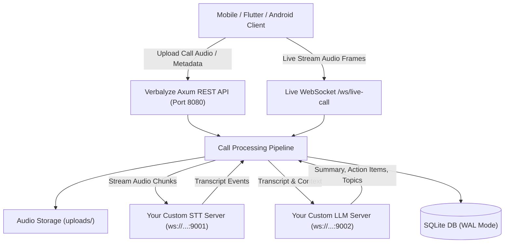

# Verbalyze Backend (Rust Rewrite)

A high-performance, asynchronous backend service built in Rust using **Axum**, **Tokio**, and **SQLite (SQLx)**. This replaces the simulated and placeholder implementations from the Flutter `notesApp` with a production-grade call note-taking, transcription, and summarization engine that connects directly to **your own custom Streaming WebSocket / gRPC Speech-To-Text (STT)** and **Large Language Model (LLM)** services.

---

## 🌟 Key Features

- **Asynchronous Architecture**: Built on **Tokio** and **Axum 0.7** for high-throughput, low-latency audio processing.
- **Custom Streaming STT Integration**: Streams call audio in real-time binary chunks over WebSockets to your custom STT server.
- **Custom Streaming LLM Integration**: Streams call transcripts to your custom LLM WebSocket to produce structured summaries, action items, key topics, and sentiment analysis.
- **SQLite with WAL Mode**: Embedded zero-maintenance database with automatic migrations, high-concurrency WAL mode, indexing, and full search capabilities.
- **Live Bidirectional Audio Streaming**: `/ws/live-call` WebSocket endpoint allowing mobile clients to stream live microphone/call audio and receive real-time interim transcripts.
- **Calendar & Contact Views**: Grouping and filtering APIs for calendar dates and contact call history.
- **Audio Storage & Streaming**: Secure file manager for uploaded audio recordings with HTTP range-friendly streaming endpoints.
- **Built-in Mock AI Server**: Includes a turnkey mock STT & LLM streaming server (`examples/mock_ai_server.rs`) for local testing.

---

## 🏗️ Architecture & Data Flow



---

## 🚀 Quick Start

### 1. Prerequisites
- **Rust toolchain** (1.75+): Ensure `cargo` and `rustc` are available.

### 2. Configure Environment
Copy `.env.example` to `.env`:
```bash
cp .env.example .env
```

Configuration variables in `.env`:
```env
SERVER_HOST=0.0.0.0
SERVER_PORT=8080
DATABASE_URL=sqlite://verbalyze.db?mode=rwc
UPLOAD_DIR=./uploads

# Your Custom STT WebSocket Endpoint
STT_WS_URL=ws://127.0.0.1:9001/ws/stt
STT_SAMPLE_RATE=16000
STT_API_KEY=

# Your Custom LLM WebSocket Endpoint
LLM_WS_URL=ws://127.0.0.1:9002/ws/llm
LLM_MODEL=custom-call-summarizer
LLM_API_KEY=

# When true, provides fallback responses if external STT/LLM are offline
ENABLE_MOCK_FALLBACK=true
```

### 3. Run the Mock AI Services (Optional for Testing)
In a separate terminal, launch the mock streaming STT and LLM server:
```bash
cargo run --example mock_ai_server
```
This runs:
- Mock STT on `ws://127.0.0.1:9001/ws/stt`
- Mock LLM on `ws://127.0.0.1:9002/ws/llm`

### 4. Run the Verbalyze Backend
```bash
cargo run
```
The server will start at `http://0.0.0.0:8080`.

### 5. Run Tests
```bash
cargo test
```

---

## 📡 Custom STT & LLM WebSocket Protocols

### Speech-To-Text (STT) WebSocket Protocol
Your STT server at `STT_WS_URL` should accept:
1. **Start Configuration Message** (JSON):
   ```json
   {
     "type": "start",
     "sample_rate": 16000,
     "encoding": "pcm_s16le",
     "language": "en",
     "api_key": "optional_token"
   }
   ```
2. **Audio Chunks**: Binary frames (`Message::Binary`) streamed in 8 KB chunks.
3. **Stop Message** (JSON):
   ```json
   { "type": "stop" }
   ```
4. **Server Response Messages** (JSON):
   ```json
   // Interim hypothesis:
   { "type": "interim", "transcript": "Hello this is...", "is_final": false }

   // Final transcription:
   { "type": "complete", "transcript": "Hello this is Alice from Sales.", "is_final": true }
   ```

### Large Language Model (LLM) WebSocket Protocol
Your LLM server at `LLM_WS_URL` should accept:
1. **Summarize Request** (JSON):
   ```json
   {
     "type": "summarize",
     "model": "custom-call-summarizer",
     "transcript": "Full text of the phone call...",
     "instructions": "Optional custom prompt directives",
     "api_key": "optional_token",
     "stream": true
   }
   ```
2. **Server Response Messages** (JSON):
   ```json
   // Streaming tokens (optional):
   { "type": "chunk", "chunk": "The client discussed..." }

   // Structured completion:
   {
     "type": "done",
     "summary": "Concise summary of the phone conversation.",
     "action_items": [
       "Send revised agreement by Friday",
       "Confirm deployment timeline"
     ],
     "key_topics": ["Contract Terms", "Deployment Schedule"],
     "sentiment": "positive"
   }
   ```

---

## 📖 REST API Reference

### 1. Upload & Process Call Recording
**`POST /api/v1/notes/upload`** (Multipart / Form-Data)

| Form Field | Type | Description |
|---|---|---|
| `audio` or `file` | File | Call audio file (`.aac`, `.wav`, `.m4a`, etc.) |
| `contact_name` | String | Contact name associated with call |
| `phone_number` | String | Phone number |
| `call_timestamp` | String | ISO-8601 timestamp (e.g. `2026-10-30T10:00:00Z`) |
| `duration_seconds`| Integer| Call duration |

**Example curl:**
```bash
curl -X POST http://127.0.0.1:8080/api/v1/notes/upload \
  -F "contact_name=Sarah Connor" \
  -F "phone_number=+14155552671" \
  -F "duration_seconds=95" \
  -F "audio=@/path/to/recording.aac"
```

**Response (200 OK):**
```json
{
  "id": "c1f7a28e-5b1e-450a-8bf8-d309228d6c70",
  "contact_name": "Sarah Connor",
  "phone_number": "+14155552671",
  "call_timestamp": "2026-10-30T14:15:00Z",
  "duration_seconds": 95,
  "audio_file_path": "58c35a8f-f1bb-45e3-96b4-cb30e5d070b4.aac",
  "transcript": "Sarah called to verify security audit results and requested a report by 3 PM.",
  "summary": "Sarah requested the final security audit report before 3 PM today.",
  "action_items": "[\"Send security audit report by 3 PM\"]",
  "key_topics": "[\"Security Audit\",\"Deadline\"]",
  "sentiment": "positive",
  "created_at": "2026-10-30T14:15:02Z",
  "updated_at": "2026-10-30T14:15:02Z"
}
```

---

### 2. Create Manual Note
**`POST /api/v1/notes`**
```json
{
  "contact_name": "John Doe",
  "phone_number": "+1234567890",
  "call_timestamp": "2026-10-30T12:00:00Z",
  "transcript": "Notes taken live during meeting...",
  "summary": "Optional predefined summary"
}
```

---

### 3. List Notes with Search & Calendar Filters
**`GET /api/v1/notes`**

Query parameters:
- `date`: Filter by date prefix (`YYYY-MM-DD`, e.g. `2026-10-30`)
- `contact`: Filter by contact name substring
- `phone`: Filter by phone number substring
- `query`: Full text search across transcript, summary, and contact
- `limit`: Number of records (default: 50)
- `offset`: Pagination offset

---

### 4. Calendar Date Grouping
**`GET /api/v1/calendar/summary`**

Returns note counts grouped by calendar date (matching the Flutter calendar widget):
```json
[
  { "date": "2026-10-30", "count": 4 },
  { "date": "2026-10-29", "count": 2 }
]
```

---

### 5. Contacts Directory
**`GET /api/v1/contacts`**

Returns all contacts with their call count and last contacted timestamp:
```json
[
  {
    "contact_name": "Sarah Connor",
    "phone_number": "+14155552671",
    "call_count": 5,
    "last_call_timestamp": "2026-10-30T14:15:00Z"
  }
]
```

---

### 6. Stream Audio Recording
**`GET /api/v1/notes/audio/:filename`**

Streams the recorded audio file with appropriate MIME type headers for in-app audio playback.

---

### 7. Direct Text Summarization
**`POST /api/v1/summarize`**

Replaces Flutter's `SummaryScreen`:
```json
{
  "text": "Paste any transcript or conversation here to summarize.",
  "instructions": "Focus on legal liabilities and deadlines"
}
```

---

### 8. Live Call Streaming WebSocket
**`ws://127.0.0.1:8080/ws/live-call`**

- Send audio chunks via WebSocket Binary messages while the call is taking place.
- Send `{"action": "finish", "contact_name": "...", "phone_number": "..."}` to stop and finalize the note.

