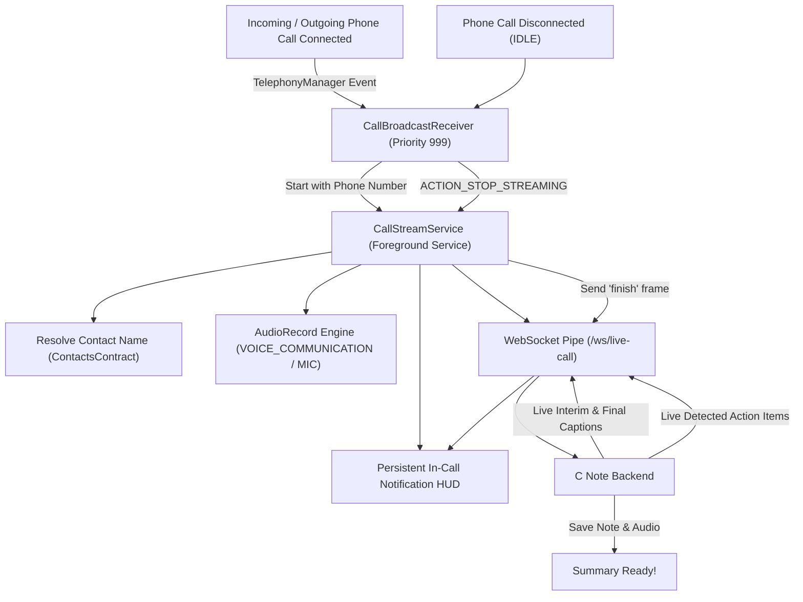

# C Note Android Companion - Real-Time Call Listening & Streaming

This module enables **C Note** to automatically listen to **all incoming and outgoing phone calls live** on an Android device, capture audio in real time, and stream it to the C Note backend for live transcription and AI note-taking.

---

## 📱 How It Works



---

## 🔑 Permissions & OS Requirements

To guarantee that the app activates on **every single call without being killed by the Android OS**, the following permissions are configured in [`AndroidManifest.xml`](AndroidManifest.xml):

### 1. Runtime Telephony Permissions
- `android.permission.RECORD_AUDIO`: Captures microphone/call audio.
- `android.permission.READ_PHONE_STATE`: Intercepts call state transitions (`RINGING`, `OFFHOOK`, `IDLE`).
- `android.permission.READ_CALL_LOG` & `READ_CONTACTS`: Matches incoming/outgoing phone numbers to saved contacts.
- `android.permission.READ_PHONE_NUMBERS`: Identifies caller ID on Android 8+.

### 2. Background Execution & Android 14+ Keep-Alive
- `android.permission.FOREGROUND_SERVICE`: Runs as an ongoing system-level service.
- `android.permission.FOREGROUND_SERVICE_MICROPHONE`: Required by Android 14 (API 34) for background microphone streaming.
- `android.permission.FOREGROUND_SERVICE_PHONE_CALL`: Required by Android 14 for telephony integration.
- `android.permission.WAKE_LOCK`: Prevents CPU sleep while the phone call is active.
- `android.permission.RECEIVE_BOOT_COMPLETED`: Automatically reactivates call listeners after device reboot.

### 3. Battery Optimization Exemption
Aggressive OEM battery managers (Samsung OneUI, Xiaomi MIUI, Google Pixel) can kill background apps. The user must grant **Battery Optimization Exemption** (`Settings.ACTION_REQUEST_IGNORE_BATTERY_OPTIMIZATIONS`), which is triggered in `PermissionHelper.requestIgnoreBatteryOptimizations(context)`.

---

## 🎙️ Modern Android Call Audio Considerations (Android 10+)

Google introduced privacy restrictions on bilateral call recording starting in Android 10 (API 29):

| Android Version | Primary Audio Source | Bilateral Capture Strategy |
|---|---|---|
| **Android 9 and below** | `AudioSource.VOICE_CALL` | Direct hardware capture of both caller and recipient. |
| **Android 10 – Android 14+** | `AudioSource.VOICE_COMMUNICATION` / `AudioSource.MIC` | Uses hardware Acoustic Echo Cancellation (AEC) and hardware beamforming. Captures the user's voice crystal-clear and the caller's voice through the speaker/earpiece. |
| **Accessibility Helper** | `CallAccessibilityService` | Companion accessibility service that provides accessibility window access to assist call audio detection. |

---

## 🛠️ Configuration

In [`CallStreamService.kt`](src/main/java/com/cnote/app/service/CallStreamService.kt), set `BACKEND_WS_URL`:
```kotlin
// Android Emulator to host:
var BACKEND_WS_URL = "ws://10.0.2.2:8080/ws/live-call"

// Physical device on local WiFi:
var BACKEND_WS_URL = "ws://192.168.1.100:8080/ws/live-call"

// Production domain:
var BACKEND_WS_URL = "wss://api.yourdomain.com/ws/live-call"
```
